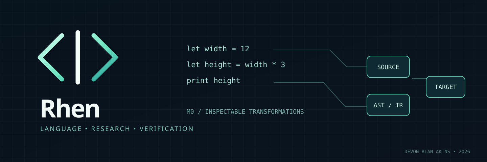

<p align="center">
  
</p>

# Rhen

**A human-readable, open-source programming language experiment with an inspectable intermediate representation and carefully bounded cross-language output.**

[Language reference](docs/LANGUAGE-M0.md) · [Architecture and research](docs/ARCHITECTURE.md) · [Contributing](CONTRIBUTING.md) · [Security](SECURITY.md)

> **M0 research build, not a production compiler.** This is a new independent programming-language repository, not the historical financial RHEN system (now [Vesper Legacy](https://github.com/devonalanakins/vesper-legacy)), the clean-sheet [Vesper](https://github.com/devonalanakins/vesper) finance redesign, the [Merit](https://github.com/devonalanakins/merit) integrity project, or the fictional language of the Anevum universe.

## Proposed full-language design

The [Rhen design RFC index](docs/rfc/README.md) links the proposed language semantics, compiler/Bridge model, offline developer tools, security boundaries, research methodology and delivery gates. **These are proposals, not current compiler functionality.** The actual M0 capabilities and limitations below remain authoritative until code is independently reviewed and merged.

## Research questions

- **Human readability:** Can the language be learned, written, reviewed, and maintained manually?
- **AI efficiency:** Can its representation reduce measurable AI-assisted development cost or error rates versus suitable baselines? No advantage is established.
- **Interoperability:** Can it preserve explicit semantics while translating or analyzing bounded subsets of multiple languages? “Manipulate any language” remains an ambition, not an implemented ability.
- **Verification:** Can structured, versioned IR make transformations reproducible and inspectable?

## The first working experiment

M0 can parse a small .rn program to deterministic JSON IR (rhen.ir.v0), then emit JavaScript or Python source from that same IR. The emitted programs check safe-integer arithmetic boundaries.

```rhen
# examples/hello.rn
let width = 12
let height = width * (2 + 1)
print height
```

Outputs 36 in JavaScript or Python when the corresponding generated program is run. Compiling does **not** run generated code.

```sh
npm run check
npm test
node bin/rhen.mjs examples/hello.rn --target ir
node bin/rhen.mjs examples/hello.rn --target js
node bin/rhen.mjs examples/hello.rn --target python
```

Node.js 22+ is needed for the development CLI and tests; Python 3 is needed only to run the Python output. There are no external runtime dependencies or mandatory services.

| M0 implemented | Beyond M0 / not yet implemented |
| --- | --- |
| Line comments; immutable `let`; `print`; variable references | Functions, loops, types, strings, standard library |
| Integers, `+`, `-`, `*`, unary negative, parentheses | Floating point, modules, tensors, effects, FFI |
| Source-to-JSON IR and JS/Python emitters | Importing JS/Python, manipulating arbitrary languages |
| Negative tests and bounds checks | Formal equivalence, performance advantage, production security |

M0 is an exploratory, narrow foundation rather than a promise of completed language design. Actual guarantees and limitations: [M0 language notes](docs/LANGUAGE-M0.md).

## Repository layout

- `src/compiler.mjs` — bounded scanner, parser, names, IR, and source emitters.
- `bin/rhen.mjs` — CLI that reads local .rn source and writes IR/target code to stdout.
- `tests/rhen.test.mjs` — positive and adversarial tests including target execution.
- `examples/hello.rn` — minimal source.
- `docs/` — grammar, research questions, boundaries.

## Evidence and contributions

Run `npm run check && npm test` and review the CI results and exact commit before relying on a change. Neither a merged PR nor passed tests prove a safe general-purpose compiler.

Rhen is designed to become fully open source and self-hostable. This PR **proposes** the MIT license; adoption is subject to maintainer approval at merge. See [CONTRIBUTING](CONTRIBUTING.md). Generated code must be reviewed and sandboxed before running untrusted examples.

**Owner:** Devon Alan Akins. **Status:** research / M0 prototype; no hosted execution, compiler package release, or verified AI efficiency benefit.
